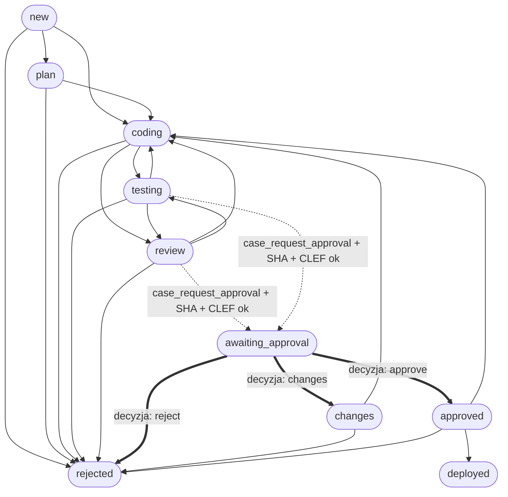

# System Obsługi Spraw Programistycznych (Cases DEV & MCP Server)

Moduł zarządzania cyklem życia zadań programistycznych (DEV ticketing), maszyny stanów oraz serwera MCP (Model Context Protocol). Zapewnia audytowalność zmian, transakcyjny magazyn plikowy JSON z blokadami procesowymi oraz separację ról między agentami AI a decydentem (właścicielem / operatorem).

---

## Architektura

```
+-------------------------------------------------------------------------+
|                              Agent AI / IDE                             |
+-------------------------------------------------------------------------+
                                    |
                    (stdio JSON-RPC / Model Context Protocol)
                                    v
+-------------------------------------------------------------------------+
|                        Serwer MCP: cases_mcp.js                         |
|   case_create, case_stage, case_assign, case_report, case_scan, itp.    |
+-------------------------------------------------------------------------+
                                    |
                             (CommonJS API)
                                    v
+-------------------------------------------------------------------------+
|                      Silnik Spraw: cases_dev.js                         |
|  - Maszyna stanów i kontrola przejść                                    |
|  - Transakcyjne zapisy atomowe (tmp + renameSync)                       |
|  - Blokada współbieżności (.lock + obsługa martwych PID)                |
|  - Integracja bramki bezpieczeństwa (CLEF guard)                        |
|  - Asynchroniczna synchronizacja (Workboard + powiadomienia decydenta)  |
+-------------------------------------------------------------------------+
           |                                              |
           v                                              v
+-----------------------+              +----------------------------------+
|  Magazyn Plikowy JSON |              |       Decydent (Operator)        |
|  DEV-1.json, DEV-2... |              | CLI: cases_dev.js decide         |
|  seq.json, sync.log   |              | lub przyciski / interfejs czatu  |
+-----------------------+              +----------------------------------+
```

### Kluczowe założenia projektowe

1. **Pojedyncze źródło prawdy (Single Source of Truth):** Wszystkie dane spraw zapisywane są w plikach JSON (`DEV-<numer>.json`). Moduł `cases_dev.js` jest jedynym uprawnionym pisarzem tych plików.
2. **Bezpieczeństwo współbieżności:** Dostęp do magazynu chroniony jest blokadą katalogową (`.lock`) z automatycznym wykrywaniem i czyszczeniem przeterminowanych blokad po martwych procesach (weryfikacja PID).
3. **Zapisy atomowe:** Każda modyfikacja pliku sprawy jest zapisywana do unikalnego pliku tymczasowego (`.tmp`) z uprawnieniami `0600`, a następnie atomowo podmieniana (`renameSync`).
4. **Separacja uprawnień (Brama Decyzyjna):** Agenci AI mogą zgłaszać ukończenie prac i prosić o zatwierdzenie (`case_request_approval`), ale serwer MCP **celowo nie posiada narzędzia do podjęcia decyzji**. Zgoda (`approval`) może zostać nadana wyłącznie przez operatora poprzez CLI (`cases_dev.js decide`) lub zewnętrzny interfejs powiadomień.
5. **Weryfikacja SHA i CLEF:** Prośba o zgodę oraz wdrożenie wymagają pełnego SHA commita oraz zielonego skanu bezpieczeństwa CLEF (`verdict: "ok"` lub uzasadnionego `bypassReason`). Jakakolwiek zmiana commita SHA lub werdyktu CLEF automatycznie unieważnia wydaną zgodę i cofa sprawę do etapu `review`.

---

## Maszyna Stanów (State Machine)

### Dozwolone etapy (`stage`)

| Etap | Znaczenie | Kto operuje |
|---|---|---|
| `new` | Nowa sprawa, wymaga wstępnej analizy | Agent / Inicjator |
| `plan` | Opracowywanie planu realizacji | Agent planujący / main |
| `coding` | Implementacja w kodzie | Agent programistyczny |
| `testing` | Wykonywanie i weryfikacja testów | Agent tester |
| `review` | Przegląd kodu i diffa | Agent recenzent / main |
| `changes` | Odesłanie do poprawek po decyzji decydenta | Decydent |
| `awaiting_approval` | Oczekiwanie na decyzję decydenta | Blokada stanu (tylko decydent) |
| `approved` | Zatwierdzona do wdrożenia | Wyłącznie decyzja decydenta |
| `deployed` | Wdrożona na gałąź główną / produkcję (zamknięta) | Wykonawca wdrożenia |
| `rejected` | Odrzucona (zamknięta) | Agent lub decydent |

### Graf przejść



### Rundy poprawek (`round` i `maxRounds`)
- Przy pierwszym wejściu w etap `coding` licznik `round` ustawiany jest na 1.
- Każdy kolejny powrót do etapu `coding` (z `testing`, `review`, `changes` lub `approved`) zwiększa `round` o 1.
- Gdy `round + 1 > maxRounds`, silnik blokuje przejście błędem `max_rounds`. Zwiększenie limitu wymaga interwencji operatora przez `bumpMaxRounds(id, n)` lub CLI.

---

## Format Danych Sprawy (JSON)

Pliki przechowywane są w `$CASES_DEV_DIR/DEV-<n>.json`.

```json
{
  "id": "DEV-1",
  "type": "dev",
  "title": "Implementacja parsowania nagłówków",
  "goal": "Dodać obsługę niestandardowych nagłówków HTTP z zachowaniem walidacji znaków.",
  "repos": ["openclaw"],
  "stage": "review",
  "assignee": "programista",
  "round": 1,
  "maxRounds": 3,
  "sha": "a1b2c3d4e5f67890123456789abcdef012345678",
  "clef": {
    "verdict": "ok",
    "sha": "a1b2c3d4e5f67890123456789abcdef012345678",
    "at": "2026-11-09T18:00:00.000Z",
    "reason": "clean"
  },
  "approval": {
    "status": "approved",
    "sha": "a1b2c3d4e5f67890123456789abcdef012345678",
    "requestedAt": "2026-11-09T18:05:00.000Z",
    "decidedAt": "2026-11-09T18:10:00.000Z",
    "decidedBy": "owner",
    "via": "command",
    "note": "Zatwierdzam wdrożenie"
  },
  "reports": [
    {
      "at": "2026-11-09T17:50:00.000Z",
      "agent": "programista",
      "kind": "report",
      "text": "WYNIK: OK\nZaimplementowano testy jednostkowe i parser.",
      "sha": "a1b2c3d4e5f67890123456789abcdef012345678"
    }
  ],
  "history": [
    { "at": "2026-11-09T17:00:00.000Z", "from": null, "to": "new", "by": "main", "note": "utworzona" },
    { "at": "2026-11-09T17:10:00.000Z", "from": "new", "to": "coding", "by": "main", "note": "rozpoczęcie prac" }
  ],
  "workboardCardId": "card-xyz123",
  "createdAt": "2026-11-09T17:00:00.000Z",
  "updatedAt": "2026-11-09T18:10:00.000Z"
}
```

---

## Interfejs CLI (`cases_dev.js`)

Skrypt `cases_dev.js` może być uruchamiany bezpośrednio w terminalu.

```bash
# Lista aktywnych spraw
node cases_dev.js list

# Lista wszystkich spraw (łącznie z zamkniętymi: deployed, rejected)
node cases_dev.js list --all

# Wyświetlenie pełnego JSON sprawy
node cases_dev.js show DEV-1

# Podsumowanie liczbowe spraw (oczekujące na zgodę, aktywne, wdrożone dzisiaj)
node cases_dev.js summary

# Decyzja operatora (approve / reject / changes) dla sprawy w stanie awaiting_approval:
node cases_dev.js decide DEV-1 approve --sha a1b2c3d4e5f67890123456789abcdef012345678 --note "Wszystko sprawdzone"
node cases_dev.js decide DEV-1 changes --sha a1b2c3d4e5f67890123456789abcdef012345678 --note "Poprawić obsługę timeoutu"
node cases_dev.js decide DEV-1 reject --sha a1b2c3d4e5f67890123456789abcdef012345678 --note "Koncepcja odrzucona"

# Ponowna synchronizacja kart tablicy Workboard
node cases_dev.js resync DEV-1 DEV-2
node cases_dev.js resync --closed

# Przebudowa karty tablicy wyłącznie z pliku sprawy
node cases_dev.js rebuild DEV-1
```

---

## Serwer MCP (`cases_mcp.js`)

Serwer MCP komunikuje się standardowym wejściem/wyjściem (`stdio`) za pomocą protokołu newline-delimited JSON-RPC 2.0.

### Eksponowane narzędzia MCP

1. **`case_create`**: Utworzenie nowej sprawy (`title`, `goal`, opcjonalnie `repos`, `max_rounds`).
2. **`case_get`**: Pobranie szczegółowych danych sprawy (`case`).
3. **`case_list`**: Lista spraw z opcjonalnym filtrowaniem po `stages`, `include_closed` oraz `limit`.
4. **`case_stage`**: Zmiana etapu sprawy (`case`, `to`, opcjonalnie `note`).
5. **`case_assign`**: Przypisanie sprawy do agenta (`case`, `agent`).
6. **`case_report`**: Zapisanie raportu prac (`case`, `text`, opcjonalnie `kind`, `sha`).
7. **`case_set_sha`**: Ustawienie commita SHA sprawy (`case`, `sha`).
8. **`case_scan`**: Wykonanie audytu diffa przez strażnika bezpieczeństwa CLEF (`case`, `sha`, opcjonalnie `repo`, `bypass_reason`).
9. **`case_diff`**: Stronicowany podgląd diffa commita z piaskownicy sprawy (`case`, opcjonalnie `sha`, `repo`, `page`).
10. **`case_request_approval`**: Złożenie wniosku do decydenta o akceptację wdrożenia (`case`, `sha`).
11. **`case_summary`**: Pobranie liczników spraw.

### Konfiguracja w kliencie MCP (np. Claude Desktop / Antigravity / OpenClaw)

```json
{
  "mcpServers": {
    "cases": {
      "command": "node",
      "args": ["/ścieżka/do/tools/cases/cases_mcp.js"],
      "env": {
        "CASES_DEV_DIR": "/ścieżka/do/danych/cases/dev",
        "CASES_DEV_BOARD_ID": "cases",
        "CASES_OWNER_NAME": "owner",
        "CASES_DEV_NOTIFY_TARGET": "id_lub_alias_powiadomien"
      }
    }
  }
}
```

---

## Zmienne Środowiskowe

| Zmienna | Domyślna wartość | Opis |
|---|---|---|
| `CASES_DEV_DIR` | `~/.openclaw/state/cases/dev` | Ścieżka katalogu z plikami spraw JSON |
| `CASES_DEV_NOTIFY_TARGET` | `""` (pusty) | Identyfikator docelowy powiadomień operatora (np. Telegram chat ID) |
| `CASES_DEV_BOARD_ID` | `"cases"` | Identyfikator tablicy zadań w Workboard |
| `CASES_OWNER_NAME` | `"owner"` | Nazwa / alias decydenta (chroniona przed podszywaniem się agentów) |
| `WORKBOARD_URL` | `"https://workboard.local"` | Bazowy adres URL tablicy Workboard dołączany do powiadomień |
| `CASES_DEV_NO_SYNC` | `""` | Ustawienie na `"1"` całkowicie wyłącza asynchroniczną synchronizację zewnętrzną (używane w testach) |
| `CASES_DEV_LOCK_WAIT_MS` | `10000` | Czas oczekiwania (ms) na zwolnienie blokady plikowej |

---

## Testy Jednostkowe

Pakiet zawiera pełny zestaw testów opartych o natywny moduł `node:test` (bez dodatkowych zależności npm):

```bash
cd tools/cases
node test_cases_dev.js && node test_cases_mcp.js && node test_cases_cross_edge.js
```

Wszystkie testy weryfikują:
- Poprawność maszyny stanów i blokowanie niedozwolonych tranzycji.
- Bezpieczeństwo współbieżności i usuwanie osieroconych blokad.
- Transakcyjność zapisów i integralność plików JSON.
- Maskowanie ścieżek sekretów i wrażliwych danych w raportach.
- Komunikację JSON-RPC przez stdio serwera MCP.
- Odporność na awarie zewnętrznych integracji (Workboard, Telegram).
